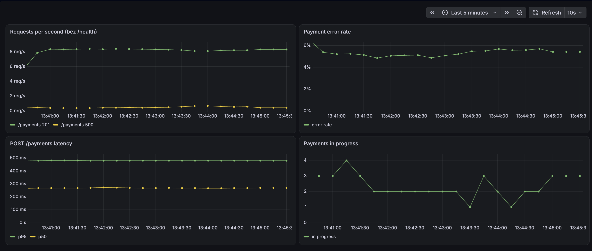
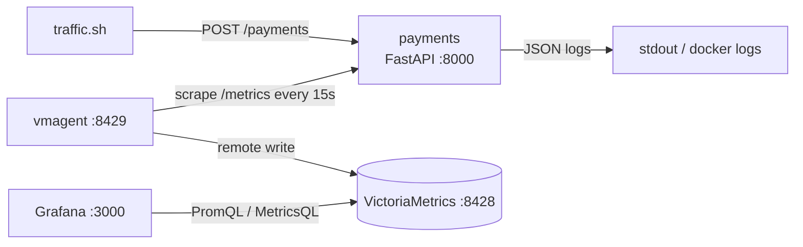

# Payment Observability Platform

An observability stack for a demo payments microservice: metrics, structured logs, dashboards as code and automation scripts. Everything runs locally with a single command.



## What this project demonstrates

- **Service instrumentation**: RED metrics (Rate, Errors, Duration) and business metrics exposed by a FastAPI service in Prometheus format
- **Cardinality control**: route templates instead of raw URLs as metric labels, IDs only in logs
- **Structured logging**: JSON Lines to stdout with a request ID for correlating log lines of a single request
- **Metrics pipeline**: vmagent scrapes the service and remote-writes to VictoriaMetrics
- **Dashboards as code**: Grafana datasource and dashboard provisioned from files in this repository
- **Container best practices**: slim image, non-root user, healthchecks, graceful shutdown, ports bound to localhost
- **Automation in Bash**: a setup script that waits for service health and a load generator with options, validation and a summary

## Architecture



## Quick start

Requirements: Docker with Docker Compose, `curl`, `openssl`.

```bash
git clone https://github.com/AdrianGhx/payment-observability.git
cd payment-observability
./scripts/setup.sh
```

`setup.sh` checks the requirements, generates a random Grafana admin password in `.env`, starts the stack and waits until every service is healthy (about 15 seconds).

Generate traffic and open the dashboard:

```bash
./scripts/traffic.sh -r 10 -d 300
```

| Service | URL |
|---|---|
| Grafana (dashboard "Payments - RED") | http://localhost:3000 (user `admin`, password in `.env`) |
| VictoriaMetrics UI | http://localhost:8428/vmui |
| vmagent targets | http://localhost:8429/targets |
| Payments API docs | http://localhost:8000/docs |

Stop the stack with `docker compose down` (metrics are kept in a Docker volume).

### Traffic generator

```
./scripts/traffic.sh [-r RPS] [-d SECONDS] [-u URL] [-h]

  -r RPS       target payments per second (default: 5)
  -d SECONDS   duration, 0 = until Ctrl+C (default: 30)
  -u URL       payments service URL (default: http://127.0.0.1:8000)
```

Payments are sent concurrently with random amounts and currencies. At the end the script prints the achieved rate, HTTP status counts and the error rate.

## Metrics

| Metric | Type | Labels | Purpose |
|---|---|---|---|
| `http_requests_total` | counter | `method`, `endpoint`, `status` | request rate and error rate |
| `http_request_duration_seconds` | histogram | `method`, `endpoint` | latency percentiles (p50, p95) |
| `payments_total` | counter | `status`, `currency` | business outcome of payments |
| `payments_in_progress` | gauge | | concurrent payments |

The service simulates a payment processor: each payment takes 50-500 ms and 5% of payments fail with HTTP 500.

## Logs

Every line is a JSON object. Each request gets a request ID (taken from the `X-Request-ID` header or generated) that is added to every log line of that request and returned in the response header.

```json
{"level": "ERROR", "message": "payment failed", "request_id": "4bde2455-...", "amount": 100.0, "currency": "PLN", "reason": "processor_error"}
{"level": "ERROR", "message": "request completed", "request_id": "4bde2455-...", "method": "POST", "endpoint": "/payments", "status": 500, "duration_ms": 163.0}
```

Find all log lines of one request:

```bash
docker logs payment-observability-payments-1 2>/dev/null | grep "<request_id>" | jq .
```

## Design decisions

- **VictoriaMetrics + vmagent** instead of a single Prometheus: Prometheus-compatible API with lower resource usage, and a separation of scraping (agent close to services) from storage that mirrors production setups.
- **Route templates as the `endpoint` label** (`/payments/{payment_id}`, not `/payments/8f3a...`): every unique label value creates a new time series, so IDs belong in logs, not in metrics. Unknown paths are grouped as `unmatched`.
- **4xx and 5xx are treated differently**: client errors are logged as WARNING, server errors as ERROR, and successful healthchecks are logged at DEBUG to keep logs free of noise.
- **Healthchecks gate startup**: Grafana starts only after VictoriaMetrics reports healthy (`depends_on: condition: service_healthy`).
- **Least privilege**: containers run as a non-root user, all ports are bound to `127.0.0.1`, secrets live in `.env`, which is not committed.
- **Everything pinned and versioned**: image versions and Python dependencies are pinned, dashboards and datasources are files in the repository.

## Lessons learned

- **Coordinated omission**: the first version of the load generator waited for each response before sending the next request and reached only ~2 payments/s with a target of 10/s. A slow service slowed down the generator itself, so the test underestimated the load. Sending requests concurrently on a fixed schedule fixed it.
- **Small samples lie**: with 30 requests the observed error rate varied between 0% and 8%; with ~10,000 requests it converged to exactly 5%. Alerts on error rate need a time window and a minimum amount of traffic.
- **Windowed queries lag**: panels using `rate(...[5m])` keep showing latency and error rate for 5 minutes after traffic stops. Latency and error panels should always be read together with request rate.
- **`localhost` is ambiguous in containers**: a healthcheck using `localhost` resolved to IPv6 while VictoriaMetrics listened on IPv4 only. Healthchecks use `127.0.0.1` explicitly.

## Repository structure

```
.
├── docker-compose.yml
├── scripts/
│   ├── setup.sh              # start the stack and wait for health
│   └── traffic.sh            # load generator
├── services/payments/        # FastAPI service, Dockerfile
│   └── app/                  # API, metrics, JSON logging
├── monitoring/
│   ├── vmagent/scrape.yml    # scrape targets
│   └── grafana/              # provisioned datasource and dashboards
└── docs/img/
```

## Roadmap

- **v0.2.0**: alerting (vmalert, Alertmanager), log collection, runbooks
- **v0.3.0**: more services, distributed tracing with OpenTelemetry, SLOs with burn-rate alerts, load tests with k6
- **v0.4.0**: CI/CD with GitHub Actions, tests, image scanning
- **v0.5.0**: Kubernetes and Helm
- **v1.0.0**: infrastructure as code and GitOps

## License

MIT
